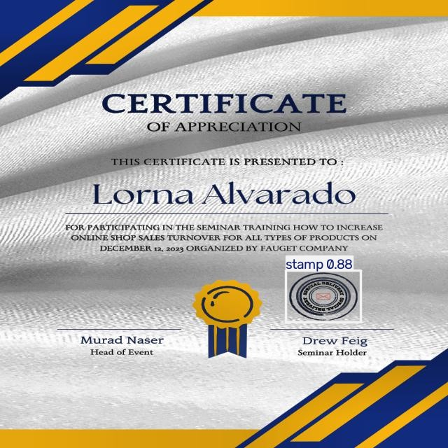
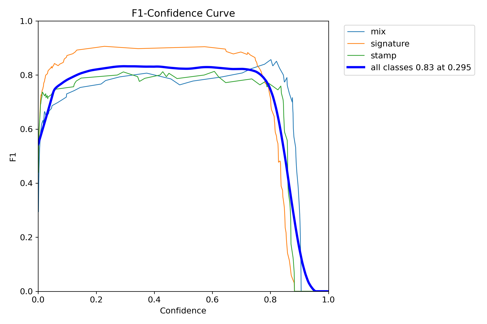
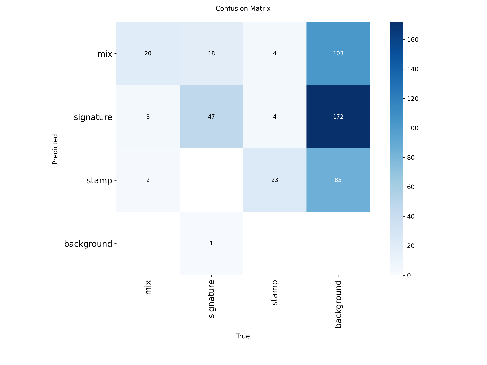

# Signature & Stamp Detection API

A FastAPI service that detects **signatures**, **stamps** and **signatures over stamps** ("mix") on uploaded certificates (images or multi-page PDFs). Built for a university application portal to check that uploaded internship certificates are signed and stamped.

**Highlights**
- Own dataset: 555 images (~350 photographed real certificates + ~205 certificate templates), annotated by hand in Roboflow.
- Found that the original validation scores were inflated by **duplicate images leaking across train/valid/test**; rebuilt the split with perceptual hashing so no near-copy crosses splits.
- Fine-tuned **YOLO26s** on the clean split. Clean held-out test set: **0.84 precision, 0.77 recall, 0.79 mAP@50**. The model finds **93%** of all marks; most errors are signature-vs-"mix" *label* confusion, not missed marks.



*Example on a certificate template (placeholder names, no personal data). Real certificates are not shown.*

---

## Results

Full numbers, threshold choice and error analysis: [`reports/evaluation.md`](reports/evaluation.md).

### Test set (55 images, 61 marks, never used for any decision)

| Class | Precision | Recall | mAP@50 | mAP@50-95 |
|---|---|---|---|---|
| **All** | **0.84** | **0.77** | **0.79** | **0.56** |
| mix | 0.67 | 0.82 | 0.76 | 0.59 |
| signature | 0.87 | 0.79 | 0.88 | 0.48 |
| stamp | 0.99 | 0.71 | 0.74 | 0.60 |

### Validation set (111 images, 122 marks, used to pick the best epoch and the threshold)

| | Precision | Recall | mAP@50 | mAP@50-95 |
|---|---|---|---|---|
| 3 classes (best epoch, 111) | 0.79 | 0.90 | 0.91 | 0.69 |
| Any mark, class ignored | 0.88 | 0.93 | 0.94 | 0.66 |

**Reading these numbers**
- **Class-agnostic recall (0.93) is higher than per-class recall.** The confusion matrix shows why: only 1 of 122 validation marks was missed entirely, while 18 of 66 signatures were labelled "mix". Where a signature ends and "signature over stamp" begins is partly a labelling judgement. For the portal's real question ("is this certificate signed and stamped?") this confusion matters less than the per-class numbers suggest.
- **Signature boxes are the loosest** (mAP@50-95 0.48): signatures have no sharp edges, so box extents vary between annotations.
- **The test set is small.** One stamp is ~6 recall points, so treat differences under ~5 points as noise.

**Confidence threshold:** the API uses `conf=0.3`, the best overall F1 (0.83) on the validation set. F1 is flat between about 0.25 and 0.7, so results are not sensitive to the exact value.




---

## The data-leakage fix

The first model (YOLOv8s, 800px, 250 epochs) reported 0.88 mAP@50 on validation. A leakage check (`tools/check_leakage.py`) compared every image across splits with perceptual hashes (pHash and dHash) and found **85 near-duplicate pairs**: the same certificate recoloured, greyscaled, brightened, or with its signature removed, uploaded as separate images and then split randomly. Roughly 15–30% of validation images had a copy in the training set.

Fix (`tools/make_clean_split.py`):
1. Group all images whose hashes differ by ≤ 8 bits (430 groups, largest 11 images).
2. Assign **whole groups** to train / valid / test (70/20/10), choosing the assignment that best balances class counts.
3. Re-run the leakage check: **zero** cross-split near-duplicates.
4. Retrain from the pretrained checkpoint, not from the old model (which had already seen copies of the new test images).

`reports/split_report.csv` lists every image, its old split, new split and duplicate group.

The old 0.88 and the new numbers are **not directly comparable**: both the split and the model changed. A fair comparison is to retrain YOLOv8s on the clean split (see Next steps).

| Model | Split | mAP@50 |
|---|---|---|
| YOLOv8s (original) | leaky validation | 0.88 (inflated) |
| YOLO26s (`yolo26s_clean`) | clean validation | 0.91 |
| YOLO26s (`yolo26s_clean`) | **clean test** | **0.79** |

---

## Dataset

| Split | Images | Signature | Stamp | Mix |
|---|---|---|---|---|
| train | 389 | 221 | 105 | 84 |
| valid | 111 | 66 | 31 | 25 |
| test | 55 | 33 | 17 | 11 |

- ~350 real internship certificates photographed by hand, ~205 certificate templates for layout variety.
- 147 images (26%) contain no marks; many are copies with the signature removed. They act as negatives, teaching the model not to fire on empty signature areas.
- Exported from Roboflow at 640×640 (stretched) with adaptive contrast equalisation; no Roboflow augmentation.
- **The dataset is private.** Real certificates contain names, signatures and company stamps (personal data under GDPR), so they are not published in this repository.

## Model and training

| Setting | Value |
|---|---|
| Base model | YOLO26s, COCO-pretrained (Ultralytics 8.4.183) |
| Image size | 640 |
| Epochs | 150 (patience 50), best epoch 111 |
| Batch | 16 |
| Hardware | Google Colab, Tesla T4 |

Full settings: `yolo_model/yolo26s_clean/args.yaml`. Training curves: `yolo_model/yolo26s_clean/results.png`.

---

## API

### Run locally

```bash
python -m venv venv
venv\Scripts\activate            # Linux/macOS: source venv/bin/activate
pip install -r requirements.txt
uvicorn app:app --reload
```

Interactive docs: http://127.0.0.1:8000/docs

Configuration (environment variables):

| Variable | Default | Meaning |
|---|---|---|
| `MODEL_PATH` | `yolo_model/yolo26s_clean/weights/best.pt` | Model weights |
| `CONF_THRESHOLD` | `0.3` | Minimum detection confidence |

### Endpoints

| Method | Path | Description |
|---|---|---|
| GET | `/test` | Health check |
| POST | `/detect` | Upload an image or PDF (`file` form field); returns detections per page |

Optional query parameter for `/detect`: `include_image` (default `true`). Set `include_image=false` to return only the detections, without the annotated image; the response shrinks from about 200 KB to under 1 KB per page.

```bash
curl -X POST http://127.0.0.1:8000/detect -F "file=@certificate.pdf"
curl -X POST "http://127.0.0.1:8000/detect?include_image=false" -F "file=@certificate.pdf"
```

Response (one entry per page):

```json
{
  "page1": {
    "detections": [
      {"bbox": [410, 432, 161, 65], "label": "signature", "confidence": 0.91}
    ],
    "image_with_annotations": "data:image/jpeg;base64,..."
  }
}
```

`bbox` is `[x, y, width, height]` in pixels. `image_with_annotations` is the page with boxes and labels drawn on it.

---

## Limitations and responsible use

- **Assistive, not a final check.** With ~7% of marks missed, the tool should flag documents for human review rather than reject them automatically.
- **Small, single-source dataset.** Collected for one university portal; other document styles, phone photos at steep angles, or faded stamps are untested.
- **Small test set** (61 marks): expect several points of variation on new data.
- **Personal data.** Uploaded documents contain personal data. The API deletes the upload, its PNG copy and any PDF page images after every request, including failed ones; deployments should still follow GDPR retention rules.

## Known issues

- PDF pages are rendered at the PyMuPDF default resolution (72 dpi), which may be low for faint signatures.

## Reproduce

```bash
pip install pillow imagehash
python tools/check_leakage.py path/to/dataset                         # find cross-split duplicates
python tools/make_clean_split.py path/to/dataset path/to/clean_split  # leak-free re-split
yolo detect train data=path/to/clean_split/data.yaml model=yolo26s.pt epochs=150 patience=50 imgsz=640 seed=0
yolo detect val model=runs/detect/train/weights/best.pt data=path/to/clean_split/data.yaml split=test
```

## Project layout

```
app.py                     FastAPI app (/test, /detect)
functions.py               PDF to images, detection, helpers
requirements.txt
yolo_model/
  yolo26s_clean/           model weights, training curves, F1/PR curves, confusion matrix, args
tools/
  check_leakage.py         cross-split duplicate check (perceptual hashing)
  make_clean_split.py      group-aware re-split
reports/
  evaluation.md            all test/validation metrics, threshold choice, error analysis
  example_prediction.jpg   sample output on a certificate template
  split_report.csv         old vs new split for every image
```

## Next steps

- Retrain YOLOv8s on the clean split for a like-for-like comparison with the original model.
- Learning curve (train on 25/50/75/100% of data) to see whether more data would help.
- Collect more real "mix" examples and hard cases (angled phone photos, faded stamps).
- Render PDF pages at a higher resolution and measure the effect on faint signatures.

## License

Code in this repository: MIT (see `LICENSE`). The model is trained and run with [Ultralytics YOLO](https://github.com/ultralytics/ultralytics), which is distributed under its own licence (AGPL-3.0 at the time of writing); the model weights and any deployment are subject to those terms.
